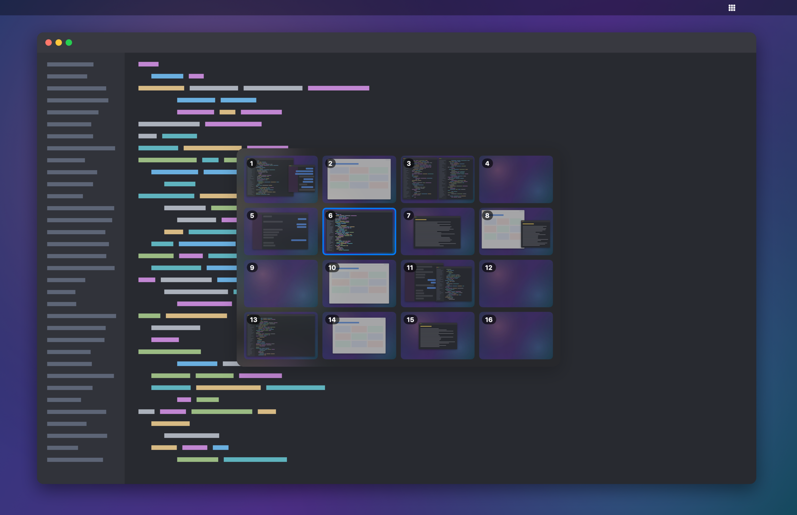
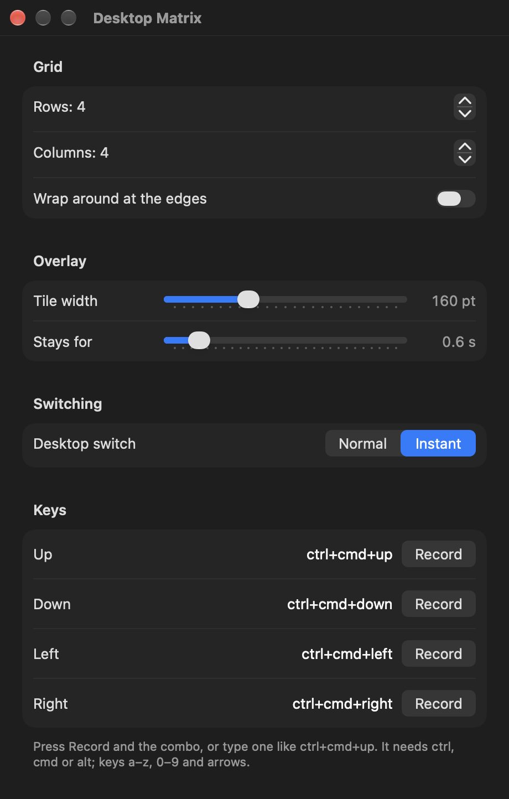

# Workspace Matrix

Your macOS desktops as a grid. Move between them with `ctrl+cmd+arrows`, like GNOME's
Workspace Matrix, with a HUD that shows where you are and a preview of every desktop.



## Features

- **Real desktops**: the grid is the native macOS desktops (Spaces), the same ones Mission Control
  and trackpad swipes show. Nothing is hidden or emulated.
- **Any grid**: 3×3, 4×4, 2×5... up to the 16 desktops macOS allows.
- **Previews** of every desktop, composed from its windows at launch and refreshed with a screenshot
  each time you arrive on or leave a desktop.
- **Instant switching** (optional): no slide animation.
- **The grid stays put** in the middle of the screen while the desktop changes underneath. It only shows
  up for its own keys; switching some other way (swipes, Mission Control, macOS shortcuts) is tracked
  quietly, so the grid and previews are still right next time.
- **No lost presses**: presses made while macOS is still switching are folded into one jump to the
  last one, so the grid never runs ahead of the screen.
- **Settings** from the menu bar icon, applied as you change them, with key combo recording.



## Requirements

- macOS 14 or later (developed on macOS 27).
- A Swift toolchain: Xcode, or the Command Line Tools (`xcode-select --install`).
- For Normal switching, the "Switch to Desktop N" shortcuts enabled in System Settings → Keyboard →
  Keyboard Shortcuts → Mission Control. The app presses them for you; Instant switching doesn't need them.

## Install

```sh
git clone https://github.com/remusxb/macos-workspace-matrix.git
cd macos-workspace-matrix
make install
```

This builds `~/Applications/WorkspaceMatrix.app` and starts it now and at every login. macOS then asks
for the two [permissions](#permissions) below; run `make restart` after granting them.
`make uninstall` removes the app and the login item.

## Permissions

Both are granted to **Workspace Matrix** in System Settings → Privacy & Security.

| permission | why | without it |
|---|---|---|
| **Accessibility** (required) | To switch desktops the app sends input on your behalf: in Normal mode it presses your "Switch to Desktop N" shortcut, in Instant mode it posts a quick trackpad swipe. macOS only lets apps with this permission post such events. | The grid shows up, but the desktop doesn't change. |
| **Screen & System Audio Recording** (optional) | For the previews: a screenshot of the screen when you arrive on or leave a desktop, and, at launch, captures of the windows on the other desktops to compose theirs. No audio is recorded; macOS just groups the two together. | Tiles show the desktop's number instead of a preview. |

What it doesn't do:

- **No keylogging.** The shortcuts are registered as system hotkeys, so the app is only told when one of
  them is pressed; it never sees anything else you type, and it doesn't ask for Input Monitoring.
  Recording a combo in Settings reads keys only while you're recording, in its own window.
- **Nothing leaves your Mac.** Previews are kept in memory only, never written to disk, and the app makes
  no network connections.

## Settings

Menu bar icon → Settings…. Everything is saved to `~/.config/workspace-matrix/config.json`, which you
can also edit by hand (then `make restart`); every field is optional, see `config.example.json`.

| field | default | |
|---|---|---|
| `rows`, `cols` | `3`, `3` | grid size; tiles past the last desktop can't be reached |
| `wrap` | `false` | moving off an edge wraps around to the other side |
| `keys` | `ctrl+cmd+up/down/left/right` | combos for `up`, `down`, `left`, `right` |
| `tileWidth` | `160` | tile width in points, shrunk so the grid never exceeds 90% of the screen |
| `hideAfter` | `0.6` | seconds the grid stays after the last move |
| `instant` | `false` | switch desktops with no slide animation |

A combo is `modifier+...+key` with at least one of `ctrl`, `cmd`, `alt` (plus `shift` if you like),
and a key from `a`–`z`, `0`–`9`, `up`, `down`, `left`, `right`. `make logs` follows what the app logs.

## How it works

- It reads which desktop you're on through read-only private SkyLight calls, the way Spaces
  indicator apps do.
- Normal switching presses your own "Switch to Desktop N" shortcut. Instant switching posts a
  synthetic trackpad swipe so fast that macOS skips the animation, ported from
  [InstantSpaceSwitcher](https://github.com/jurplel/InstantSpaceSwitcher).
- The grid lives in its own always-visible space above the desktops, so it doesn't slide with them.

None of this needs System Integrity Protection turned off, but private APIs can change with any macOS
update; [docs/ARCHITECTURE.md](docs/ARCHITECTURE.md#private-apis) lists each one and what stops working
without it.

## Limitations

- One display: the grid follows the main screen's desktops.
- It can't add or remove desktops (macOS has no API for it): use Mission Control's **+**.
- Windows move between desktops the usual way, by dragging them in Mission Control.

## Develop

```sh
make check    # the gate: lint, a warning-free build, the tests (CI runs it too)
make fmt      # format the code
make install  # build and run your changes
make logs     # follow the app's log
```

How the code is laid out and why: [docs/ARCHITECTURE.md](docs/ARCHITECTURE.md). The rules it follows:
[docs/STANDARDS.md](docs/STANDARDS.md). What changed: [CHANGELOG.md](CHANGELOG.md).

## Credits

Instant switching is ported to Swift from [InstantSpaceSwitcher](https://github.com/jurplel/InstantSpaceSwitcher)
by jurplel, under the MIT license ([its notice](LICENSES/InstantSpaceSwitcher.txt)).

## License

[MIT](LICENSE)
