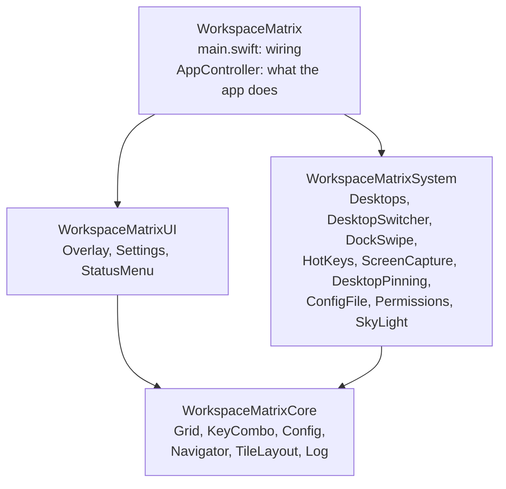
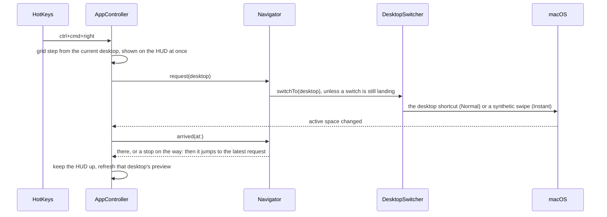

# Architecture

Workspace Matrix is a menu bar app that lays macOS's own desktops out as a grid. It never emulates desktops:
it reads where macOS is and asks macOS to switch, so Mission Control, swipes and the grid always agree.

## Modules

| module | holds | may import |
|---|---|---|
| Core | the logic that doesn't need macOS: grid steps, key combos, settings and their file format, the switch queue, tile geometry | Foundation, CoreGraphics, os |
| System | one adapter per macOS facility; every private call | Core, AppKit, Carbon, ScreenCaptureKit |
| UI | the grid HUD, the settings window, the menu bar icon | Core, AppKit, SwiftUI |
| App | `AppController` and the interfaces it needs; `main.swift`, which builds everything and connects it | all of the above |

System and UI don't know about each other: where one needs the other, the app passes it in (the HUD is pinned
above the desktops by a function from System, handed to it as a closure). `AppController` sees System and UI
only through the interfaces in `Interfaces.swift`, so its tests run on fakes.

## A key press

- **The Navigator** exists because macOS drops desktop shortcuts pressed while it's still switching. Presses
  that arrive mid-switch are folded into one jump to the last one, and a switch that never lands is retried
  once.
- **The HUD shows only for the app's keys.** Every desktop change, by any means, still updates the position
  and the previews.
- **Previews:** at launch, each desktop's preview is composed from its windows over the wallpaper, like
  Mission Control does; after that a screenshot replaces it whenever you arrive on or leave that desktop.

## Private APIs

macOS has no public API for desktops. These are the private ones, all declared in `SkyLight.swift` and looked
up at runtime; none needs System Integrity Protection off.

| call | for | without it |
|---|---|---|
| `SLSMainConnectionID`, `SLSGetActiveSpace`, `SLSCopyManagedDisplaySpaces` | which desktop is active, how many there are | the app can't tell where you are; keys don't move |
| `SLSCopySpacesForWindows` | which desktop a window is on, for previews at launch | tiles stay empty until visited |
| `SLSSpaceCreate`, `SLSSpaceSetAbsoluteLevel`, `SLSShowSpaces`, `SLSAddWindowsToSpaces` | a space of the HUD's own above the desktops, so it stays still while they slide | the HUD slides with the desktops |
| undocumented CGEvent gesture fields and the IOHID payload (`DockSwipe`) | Instant switching | Normal switching still works |

Instant switching is ported from [InstantSpaceSwitcher](https://github.com/jurplel/InstantSpaceSwitcher)
(MIT); its golden test holds the exact bytes the Dock receives.

## Distribution

`make install` builds the app bundle into `~/Applications`, signs it ad hoc with a fixed designated
requirement (so the permissions macOS granted survive rebuilds), and runs it as a launchd agent at login.
